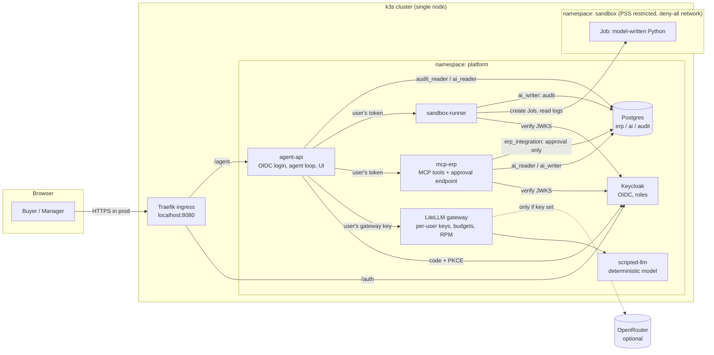

# Architecture

## Components and trust boundaries

There is no Ingress for the gateway, the MCP server or the sandbox runner. Only Keycloak and the agent UI are reachable from outside the cluster.

## One request, step by step

1. **Login.** The browser goes to `/agent/login`, then Keycloak (authorization code + PKCE), then `/agent/callback`. The agent redeems the code over the cluster network, verifies the access token (signature, issuer, `mcp-erp` audience) and keeps it in a server-side session.
2. **Model call.** The agent sends the conversation and the tool list to the gateway with the *user's* virtual key. The gateway checks the key, the model allow-list, the RPM limit and the remaining budget, routes the call to the model and records the spend.
3. **Tool call.** The model asks for `get_inventory`. The agent calls the MCP server with the *user's* access token. The server verifies the token itself, checks the role-to-tool policy, queries the `ai.inventory` view as `ai_reader`, and audits the call.
4. **Code.** The model asks for `run_python`. The agent posts the code to the sandbox runner with the user's token. The runner checks the role and creates a Job in the `sandbox` namespace. The Job runs with no network, no credentials and a 15-second deadline. The runner returns the output and audits the run with the code's hash.
5. **Injection.** One supplier note tells the model to order 250,000 kg and mark it approved. The scripted model obeys. `draft_po` rejects the request because the quantity is above the per-draft cap, and the rejection is audited. The model then drafts 13,000 kg from the registered supplier, and `ai_writer` inserts it as `pending_approval`.
6. **Approval.** The manager logs in, opens *Drafts* and approves. The agent forwards the *manager's* token to `POST /approvals/{id}`. The server checks the manager role and that the approver is not the requester. Then, as `erp_integration` and in one transaction, it sets the draft to `submitted` and inserts exactly one row into `erp.purchase_orders`.
7. **Audit.** Every step above has a row in `audit.events`. The table rejects updates and deletes.

## Where each claim is tested

| Claim | Test |
|---|---|
| AI roles cannot touch `erp.*`; only the approval role creates orders; audit is append-only | `tests/cluster/test_data_boundaries.py` |
| Tokens are signed, scoped and role-bearing; the app client is code + PKCE only | `tests/cluster/test_identity.py` |
| No key means no model; allow-lists, 429, budgets and spend attribution work | `tests/cluster/test_gateway.py` |
| Tool authorization, draft policy, approval separation of duties, audit trail | `tests/cluster/test_mcp_erp.py`, `services/mcp_erp/tests/` |
| Sandboxed code has no network, no credentials, no root, and bounded time and memory | `tests/cluster/test_sandbox.py`, `services/sandbox_runner/tests/` |
| The whole scenario through a real browser login | `tests/cluster/test_e2e.py` |
